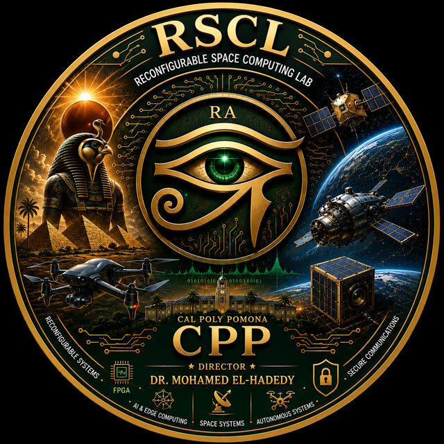
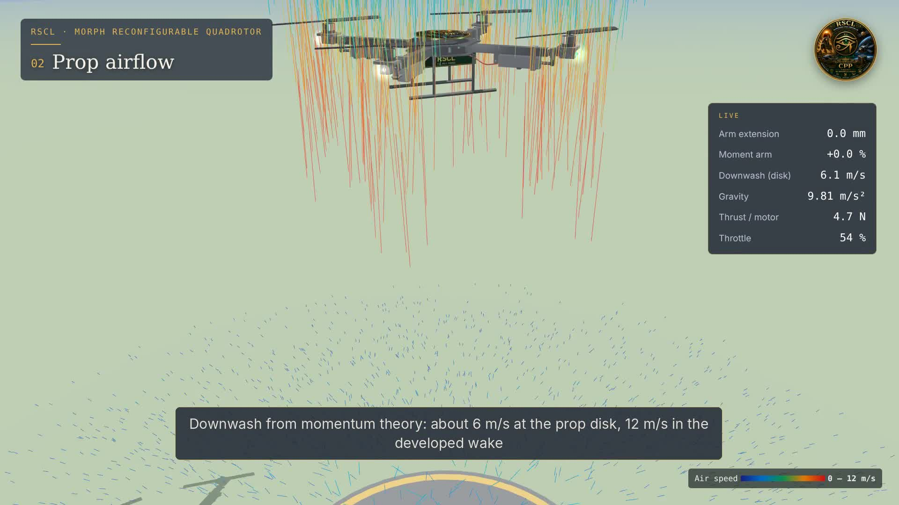
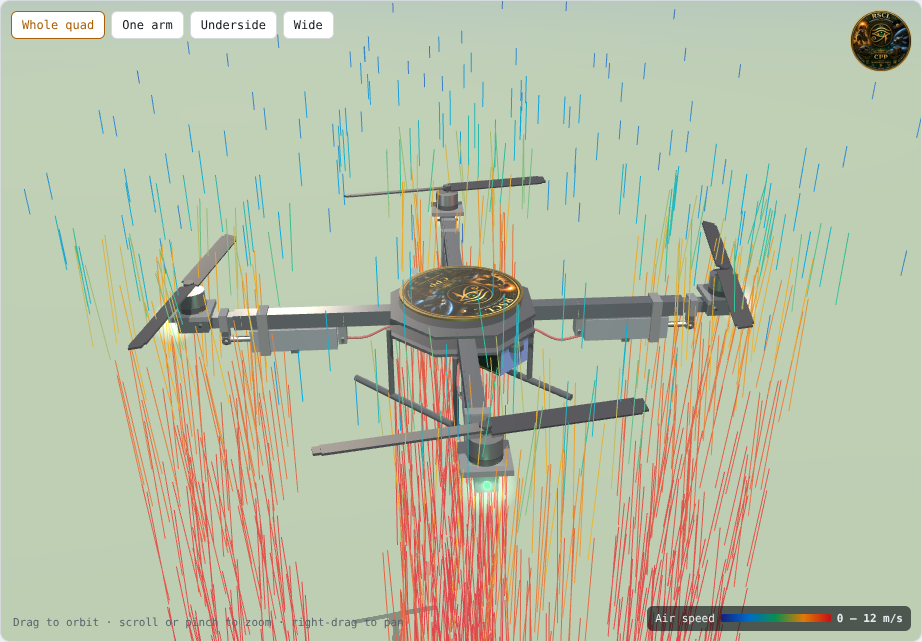
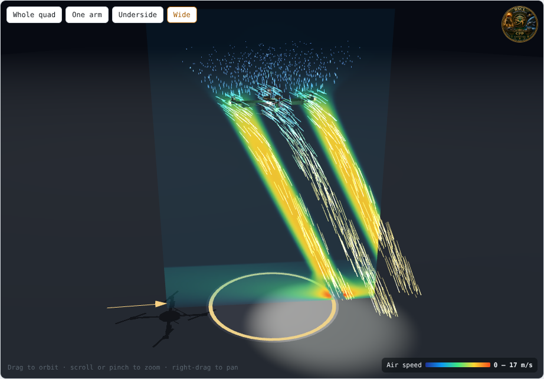

<h1 align="center">NEKHBET</h1>

<b>3D flight simulator for the MORPH telescoping-arm quadrotor</b> 
Reconfigurable Space Computing Lab (RSCL) · Cal Poly Pomona

Named for Nekhbet, the Egyptian vulture goddess shown with her wings spread wide: a flyer whose span extends.

**Run it:** open `index.html` in any modern browser, or use the GitHub Pages site for this repo. No install and no build step; three.js r128 loads from a CDN.

**Demo video:** [`media/nekhbet-demo-720p.mp4`](media/nekhbet-demo-720p.mp4), 1:42.

## What it simulates

| Area | Model |
|---|---|
| Airframe | 450-class quad with four telescoping arms; 16 mm square carbon outer tube, 12 mm sliding inner tube on PTFE bushings, printed PA-CF motor mount, collar and clamps |
| Actuator | Actuonix L16-R (L16-50-63-6-R): 50 mm stroke, 20 mm/s no-load, RC PWM input |
| Prop airflow | Actuator-disk momentum theory per rotor: induced velocity from thrust, wake contraction to twice the disk velocity, swirl, wind skew, ground wall jet, Cheeseman–Bennett ground effect |
| Velocity slice | Vertical plane through two rotors, colored by air speed, turning to face the camera |
| Flight | 1.9 kg all-up, 4 × 1.6 kgf max thrust; fixed-gain attitude and position loops respond to mean wind and gusts |
| Environment | Wind speed, direction and gusts; rain driven down through the prop wash; lightning; day, dusk, night and studio lighting; Earth, Mars, Moon and Jupiter gravity |
| Lights | Red and green navigation lights, white anti-collision strobe, landing light |
| Readouts | Arm geometry, moment arm, inertia, thrust per motor, throttle, thrust margin, gust wobble, position wander, downwash, ground effect |

## Limits

- The airflow is a physics-based momentum model, **not a Navier–Stokes CFD solution**. Tracer motion runs in slow motion for readability; colors show true air speed. OpenFOAM validation is planned.
- Air density stays at sea level for every gravity preset, so Mars and Moon show the gravity load only.
- The actuator body cross-section is approximate; check the Actuonix drawing before finalizing clamp geometry.
- Use the simulator to compare configurations, not to clear a flight.

 

## Credits

Prof. Mohamed El-Hadedy, Director, Reconfigurable Space Computing Lab, Cal Poly Pomona · [recoiot.com](https://recoiot.com) · [github.com/mealycpp](https://github.com/mealycpp)
